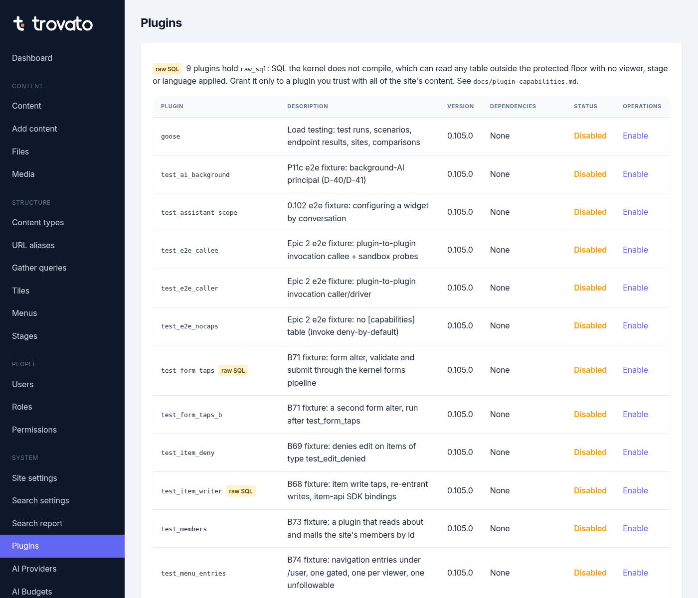

# Plugin capabilities

What each key under `[capabilities]` in a plugin's `{name}.info.toml` grants,
and what it costs to grant it. This is the page to read before installing a
plugin: the manifest is the whole of what a plugin may do, and the kernel
enforces it.

A manifest with no `[capabilities]` table gets nothing: no host interface, no
tables, no `raw_sql`. A plugin that declares the table gets exactly what it
names. The struct is `PluginCapabilities` (`crates/kernel/src/plugin/info_parser.rs`).

```toml
[capabilities]
host_interfaces = ["logging", "query", "item-api"]
db_tables       = []         # tables beyond the ones the plugin's migrations create
raw_sql         = false
item_background = false
```

## The keys

| Key | Default | Grants |
|---|---|---|
| `host_interfaces` | `[]` | The host interfaces the plugin's linker exposes. A call to one it did not declare cannot link. The names are in [the list below](#host-interfaces). |
| `db_tables` | `[]` | Tables the `db` calls and `query` may reach beyond the ones the plugin's own migrations create. The kernel's protected tables (users, roles, tokens, site config, the plugin registry and the rest of the protected floor, `PROTECTED_TABLES` in `plugin/db_policy.rs`) are refused whatever this says. Content tables do not belong here: read content with `query`, write it with `item-api`. |
| `raw_sql` | `false` | `db.query-raw` and `db.execute-raw`. See [`raw_sql`](#raw_sql). |
| `item_background` | `false` | `item-api` and content reads through `query` from cron and the queue worker, where there is no user, with kernel authority. Without it those calls are refused (-61). |
| `ai_background` | `false` | `ai-request` from cron and the queue worker, charged to the plugin's own budget. |
| `user_directory` | `false` | `user-api.load-users`, `find-user-by-name` and `find-users-by-name-prefix`: public facts about other members, by id, exact name or name prefix. Never an address. |
| `mail_users` | `false` | `mail.send-to-user`: mail a member by id, the kernel resolving the address. |
| `http_max_transfer` | 1 MB | The byte ceiling of one streaming HTTP fetch, clamped to 16 MB. |
| `public_functions` | `[]` | Functions other plugins may call through `plugin-api.invoke`. |

## Host interfaces

`item-api`, `db`, `variables`, `request-context`, `user-api`, `cache-api`,
`plugin-api`, `logging`, `ai-api`, `crypto-api`, `http`, `queue`, `mail`,
`text-format`, `query`. What each holds is in `crates/wit/kernel.wit` and
[plugin-development.md](plugin-development.md#host-functions).

Two of them are how a plugin does ordinary website work without `raw_sql`:

- **`query`** runs a Gather definition. Over content it reads for the request's
  viewer, on the request's stages, in its language, and returns each row's URL;
  the plugin cannot switch any of that off. Over the plugin's own tables it
  reads them as they are, with grouping and aggregates.
- **`item-api`** reads and writes items and their translations through the
  kernel's item service, which decides access, fires the item taps and keeps
  the item cache right.

`db` covers the plugin's own tables: `select`, `insert`, `update` and `delete`
with conditions, `upsert`, and `insert-many` up to 500 rows.

## `raw_sql`

> `raw_sql` lets a plugin run SQL the kernel does not compile: it can read any
> table outside the protected floor with no viewer, stage or language applied,
> so grant it only to a plugin you trust with all of the site's content, and only
> when the query seam and the structured `db` writes cannot express what it does.

What the kernel still checks on a raw statement: it is parsed as PostgreSQL and
judged as a tree, `query-raw` takes one read and runs in a `READ ONLY`
transaction, `execute-raw` takes one `INSERT`, `UPDATE` or `DELETE`, neither may
name a protected table or call a function that changes session state or reads
the server's files, and a statement that does not parse is refused. What it does
not check is which rows the statement reads: unpublished items, other stages,
fields a visitor may not see. That is the risk an administrator takes on.

What still needs it, because Gather will not compile it: recursive CTEs, window
functions, extension operators, and locking reads such as
`FOR UPDATE SKIP LOCKED` in a writing CTE. A listing, a sitemap, an index sorted
by a field, a lookup by URL, a translation sync, an upsert, a batch insert and a
count per group do not: `plugins/test_site_queries` does all of them with no
`raw_sql`.

**Where a grant shows.** Every holder is visible in three places:

- the manifest, `raw_sql = true` under `[capabilities]`;
- the admin plugin listing (`/admin/plugins`), which marks each holder
  **raw SQL** and says above the table how many hold it;
- the boot log, one warning naming every loaded holder:
  `plugins holding raw_sql: SQL the kernel does not compile, with no viewer, stage or language applied plugins=trovato_search`.
  It names the loaded (enabled) holders; the listing marks every holder on
  disk, enabled or not.



The design, and why `raw_sql` stays one flag rather than a read and a write
grant, is [plugin-query-surface.md](design/plugin-query-surface.md) (D-60).
