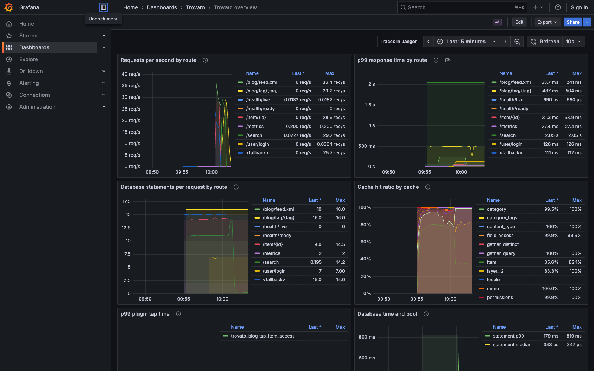
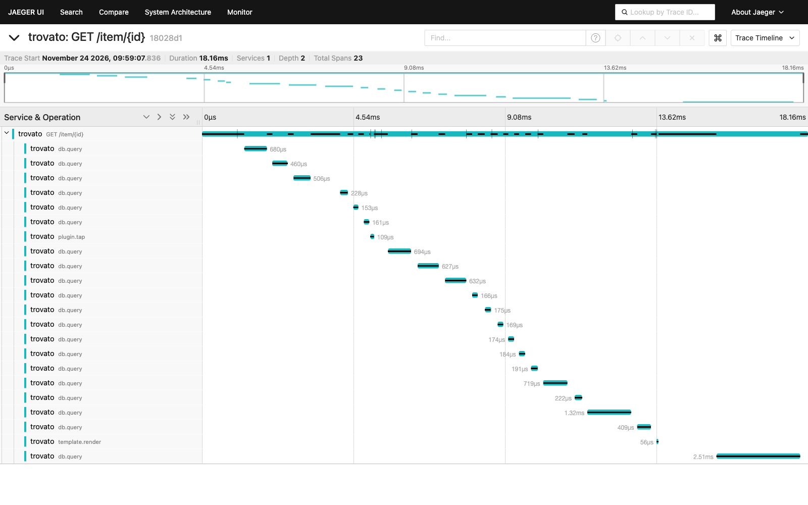
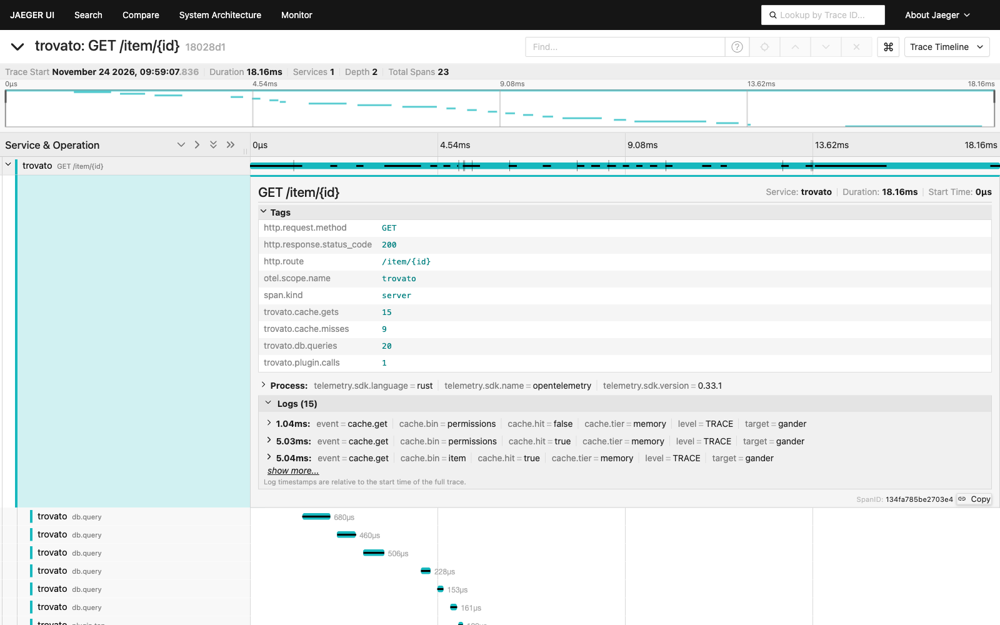
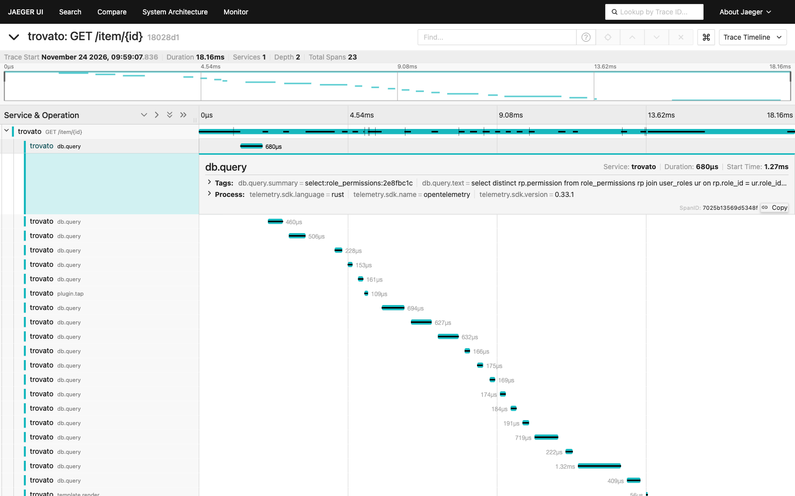

# Tracing and metrics

What one request did, and where its time went. Two parts:

- **For operators**: turning on trace export, protecting `/metrics`, and the
  local viewer.
- **For contributors**: [Reading a trace](#reading-a-trace).

The design and the reasons behind it are in
[design/tracing-and-performance-tests.md](design/tracing-and-performance-tests.md).
Exact per-page counts, which CI checks, are in
[performance-tests.md](performance-tests.md).

## What is traced

Every request is a span, `http.request`, named for its method and its route
template (`GET /item/{id}`), never its path. Inside it:

| Span | One per | Attributes |
|---|---|---|
| `db.query` | database statement a request makes (statements in queue jobs and background tasks are not counted and not exported) | `db.query.summary` (the fingerprint, `select:item:1a2b3c4d`), `db.query.text` (the SQL with every literal and parameter replaced by `?`), `db.response.returned_rows` |
| `cache` (`cache.get`, `cache.set`, `cache.invalidate`, `cache.invalidate_tag`) | Redis cache call | `cache.tier=redis`, `cache.bin` (the key's first segment), `cache.hit` |
| an event `cache.get` on the enclosing span | in-process cache lookup | `cache.tier=memory`, `cache.bin`, `cache.hit` |
| `plugin.tap` | plugin tap call | `trovato.plugin`, `trovato.tap` |
| `plugin.host_call` | host function a plugin calls | `trovato.plugin`, `trovato.host.module`, `trovato.host.function` |
| `gather.execute` | gather query | `trovato.gather.base_table`, `trovato.gather.item_type` |
| `template.render` | template render | `trovato.template.kind` |
| `http.client` | outgoing HTTP request (AI providers, webhooks) | method, host only, status; for AI calls the provider and model |

Queue jobs are root spans of their own, `queue.job`, with the plugin, queue,
attempt and outcome. Any other span that starts outside a request or a job (a
plugin tap from a cron tick, a Redis call from a background task or at
startup) is a trace of its own too, one span long, sampled at the same ratio. The request span also carries the request's counts:
`trovato.db.queries`, `trovato.cache.gets`, `trovato.cache.misses` and
`trovato.plugin.calls`.

**Never in a span**: a path or query string, a header, a cookie, a bound
parameter, a cache key past its first segment, a user id, a name, an email, a
body. A test (`telemetry_privacy_test`) seeds a password, an email, a reset
token, an API token and a search term, sends them through the site with
export on, and fails if any of them reaches an exported span, the log,
`Server-Timing` or `/metrics`.

## Exporting traces

Export is off by default. Off, it costs nothing: no layer is interested in
the spans, so none is ever built (`tracing_off_test` counts the allocations).

Turn it on with one variable and point it at an OTLP endpoint:

```sh
TRACING_EXPORT=otlp
OTEL_EXPORTER_OTLP_ENDPOINT=http://collector.internal:4318
```

Trovato speaks OTLP over HTTP with protobuf, which Jaeger, Grafana Tempo,
Honeycomb, Datadog, New Relic, Elastic and the OpenTelemetry Collector all
accept. There is no gRPC.

| Variable | Default | What it does |
|---|---|---|
| `TRACING_EXPORT` | `off` | `otlp` to export. Anything else stops the server at startup, so a typo does not quietly leave export off. |
| `OTEL_EXPORTER_OTLP_ENDPOINT` | `http://localhost:4318` | The collector's base URL; `/v1/traces` is added. |
| `OTEL_EXPORTER_OTLP_TRACES_ENDPOINT` | | The full traces URL, when it is not `<base>/v1/traces`. |
| `OTEL_EXPORTER_OTLP_HEADERS` | | Headers for every export, `key=value,key=value`: a hosted backend's API key goes here. |
| `OTEL_EXPORTER_OTLP_TIMEOUT` | `10000` | Milliseconds one export may take. |
| `OTEL_SERVICE_NAME` | `trovato` | The service name traces are filed under. Give each site or environment its own. This is the only way to name the service: a `service.name` in `OTEL_RESOURCE_ATTRIBUTES` is overridden. |
| `OTEL_RESOURCE_ATTRIBUTES` | | More resource attributes, `deployment.environment=production,...` |
| `OTEL_TRACES_SAMPLER_ARG` | `1.0` | The share of requests and queue jobs traced, 0 to 1. Each request starts a trace of its own (an incoming `traceparent` header is not read), and everything inside a request is traced or not with it. `OTEL_TRACES_SAMPLER` is not read. |

Spans are sent by a batch processor on a thread of its own: a request never
waits on the collector, and a collector that is down costs dropped spans, not
slow pages. On shutdown the spans still in the batch are sent, for up to 3
seconds; a collector that is down then costs those spans, not a late exit.

A failed export is not logged: an endpoint that is wrong or down, or a hosted
backend that refuses the API key in `OTEL_EXPORTER_OTLP_HEADERS`, shows as
traces that never arrive. When none do, check the endpoint from the server
itself, for example
`curl -si -X POST -H 'content-type: application/x-protobuf' <endpoint>/v1/traces`
(with the same headers), which a working collector answers with a 200 or a
400, not a connection error or a 401.

Examples:

```sh
# Jaeger, or an OpenTelemetry Collector, on the same network
TRACING_EXPORT=otlp OTEL_EXPORTER_OTLP_ENDPOINT=http://jaeger:4318

# Grafana Tempo
TRACING_EXPORT=otlp OTEL_EXPORTER_OTLP_ENDPOINT=http://tempo:4318

# Honeycomb (EU: api.eu1.honeycomb.io)
TRACING_EXPORT=otlp OTEL_EXPORTER_OTLP_ENDPOINT=https://api.honeycomb.io \
  OTEL_EXPORTER_OTLP_HEADERS=x-honeycomb-team=<api key>

# A busy site: one request in twenty
TRACING_EXPORT=otlp OTEL_TRACES_SAMPLER_ARG=0.05
```

### What it costs

Measured on a 20,000,000 post site on a Mac Studio: each figure is the median
over 3 runs of 2,000 requests from 8 clients (`scripts/bench.sh`), and each
cell gives two such sets, in milliseconds, median / p99. Export on sent every
request to a Jaeger on the same machine (`OTEL_TRACES_SAMPLER_ARG=1.0`), and
Jaeger held a trace for every one of them afterwards: nothing was dropped.

| Page | Before BG14 | Export off | Export on, every request |
|---|---|---|---|
| item | 10.04 / 14.27, 9.96 / 13.35 | 9.85 / 12.45, 9.92 / 13.38 | 10.01 / 12.45, 11.99 / 15.29 |
| front | 40.75 / 54.97, 41.63 / 54.33 | 40.24 / 54.92, 40.69 / 54.14 | 42.38 / 56.28, 40.98 / 55.18 |
| feed | 41.28 / 52.08, 39.43 / 51.47 | 39.69 / 52.81, 39.54 / 51.65 | 40.30 / 52.96, 40.01 / 51.02 |

Export off is the same as before, within the noise between two sets. Export
on, tracing everything, costs at most a couple of milliseconds a request and
often nothing measurable: the spans are built on the request's thread and
encoded and sent on the batch thread. With sampling, a request left out
builds its spans but records nothing in them, and its statements are not
normalised, so most of the cost goes with the share left out.

## Metrics

`/metrics` serves Prometheus text: request counts and durations by route
template, statements per request, cache hits, misses and sets per cache,
statement and plugin tap durations, the connection pool and circuit breaker
states.

It answers an operator only:

- a request from a loopback address that carries no `Forwarded`,
  `X-Forwarded-For` or `X-Real-IP` header (a Prometheus or an agent on the
  same host), or
- a request with `Authorization: Bearer <METRICS_TOKEN>`, from anywhere.

Anything else gets a 404, as if the route did not exist. Both answers are
sent with `Cache-Control: no-store`.

A reverse proxy on the same host connects from a loopback address too. It
must add `X-Forwarded-For`, `X-Real-IP` or `Forwarded` to every request it
passes on, or a visitor coming through it reads `/metrics` as a local caller.
Most proxy setups do (Caddy and Traefik by default), but nginx adds nothing
unless told to: add `proxy_set_header X-Forwarded-For
$proxy_add_x_forwarded_for;`, or have it refuse the path itself
(`location = /metrics { return 404; }`). Setting `METRICS_TOKEN` does not
close the loopback route.

`METRICS_TOKEN` must be at least 32 characters (`openssl rand -hex 32`). A
Prometheus on another host sends it:

```yaml
scrape_configs:
  - job_name: trovato
    metrics_path: /metrics
    authorization:
      type: Bearer
      credentials_file: /etc/prometheus/trovato-metrics-token
    static_configs:
      - targets: ["blog-1.internal:3000"]
```

Before this, `/metrics` answered anyone who could reach the server. A
Prometheus on another host that scraped it without a token gets 404s after
the upgrade until it is given one.

## A local viewer

For a developer's machine: Jaeger for traces, Prometheus scraping the server,
and Grafana with one dashboard.

```sh
docker compose -f docker/observability/docker-compose.yml up -d

TRACING_EXPORT=otlp METRICS_TOKEN=local-observability-token-not-for-production \
  cargo run --release
```

- Jaeger: <http://localhost:16686>, service `trovato`.
- Grafana: <http://localhost:3001>, dashboard *Trovato > Trovato overview*:
  requests per second and p99 by route, statements per request by route,
  cache hit ratio by cache, plugin tap p99 and statement time.
- Prometheus: <http://localhost:9090>.

The token in `docker/observability/prometheus/prometheus.yml` is a fixed one
for this purpose only; Grafana lets anyone in as an administrator; every port
is bound to `127.0.0.1`. None of it is for a server. The ports can be moved
with `JAEGER_UI_PORT`, `OTLP_HTTP_PORT`, `PROMETHEUS_PORT` and `GRAFANA_PORT`,
and the scrape target (`host.docker.internal:3000`) is in the Prometheus file.
On Linux, `host.docker.internal` comes from the `extra_hosts` entry in the
compose file (`host-gateway`), and the server must listen on an address the
containers can reach, not only `127.0.0.1`.

`docker compose -f docker/observability/docker-compose.yml down` stops it.



## Reading a trace

Run the local viewer, load a page, and open Jaeger. Search for service
`trovato` and the operation (`GET /item/{id}`), and open a trace.



Each row is a span; the bar shows when it ran inside the request. Read it
top to bottom:

1. **The request span** (`GET /item/{id}`). Its length is the whole request.
   Open it for its tags: the route, the status, and the request's counts
   (`trovato.db.queries`, `trovato.cache.gets`, `trovato.cache.misses`,
   `trovato.plugin.calls`). Its **Logs** are the in-process cache lookups, in
   order, each with its cache and whether it hit.

   

2. **`db.query` spans**, one per statement. Open one: `db.query.summary` is
   the fingerprint the performance tests use, and `db.query.text` the
   statement with its values replaced, so it reads the same for every user.

   

3. **`plugin.tap`**: a call into a plugin (here `tap_item_access`, because the
   author viewing their own unpublished post is past the published fast path).
   Its host calls, if the plugin made any, are inside it.
4. **`template.render`**: the render. The statements after it are work that
   rendering asked for.

What to look for:

- **The same statement many times.** Several `db.query` spans with the same
  `db.query.summary` in one request is a loop that queries once per row: the
  N+1. Jaeger's search can filter by tag
  (`db.query.summary=select:users:…`).
- **Gaps.** Time in the request span that no child covers is the kernel's own
  work: building the page, a lock, a slow plugin's WASM start.
- **A statement that is slow every time.** Copy its `db.query.text` into
  `EXPLAIN ANALYZE`, with real values in place of the `?`s.
- **Cache misses on a warm page.** Logs with `cache.hit=false` on a second
  load mean something is not cached, or its entry is being invalidated.

When a performance test fails, its message lists statements by the same
fingerprint a trace shows, so the trace of the page tells you where in the
request the new statement runs.
